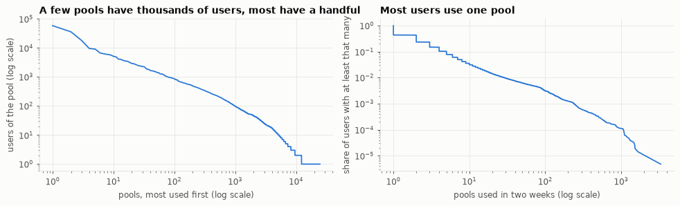
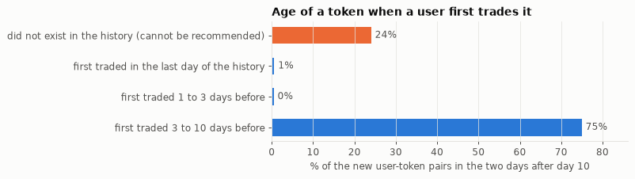
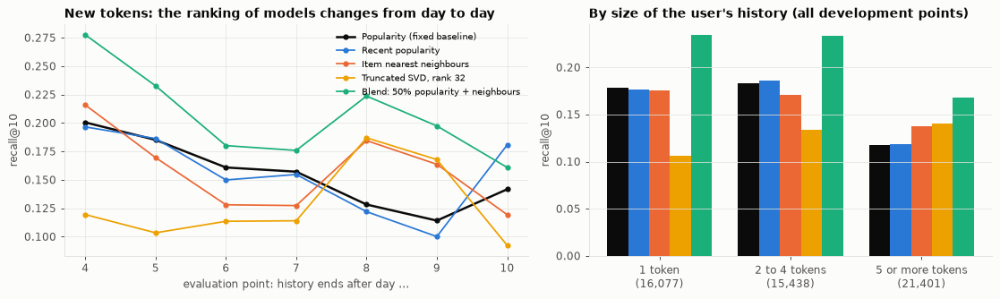

# Project plan: next-token recommendation for DEX traders

**Which token will a trader pick up next?** Trading accounts on Ethereum's
Uniswap-style exchanges are treated as users and tokens as items. For each
account, the system ranks the tokens it has never traded by how likely it is
to trade them for the first time in the following two days.

This plan builds on a completed feasibility study. Everything marked
**done** below has been run and can be reproduced; everything marked
**planned** is the project work.

- Feasibility write-up: [`pool_recommendation_writeup.md`](pool_recommendation_writeup.md)
- Literature review: [`literature/literature_review_pool_recommendation.md`](literature/literature_review_pool_recommendation.md)
- Notebook with all numbers and charts: [`../src/notebooks/05_pool_recommendation_data_and_baseline.ipynb`](../src/notebooks/05_pool_recommendation_data_and_baseline.ipynb)
- Code: [`../src/scripts/dex_swaps.py`](../src/scripts/dex_swaps.py) (download), [`../src/scripts/pool_recsys.py`](../src/scripts/pool_recsys.py) (models and metrics), tests in [`../tests/`](../tests/)

The idea started as "next-*pool*" recommendation. The data showed that
routers, not traders, choose pools, so the item is now the token
(section 4.1). File names still say "pool".

## Where each grading criterion is answered

| Criterion | Section |
| --- | --- |
| (a) Literature: citations, review of prior work | [2](#2-literature) and [References](#references) |
| (b) Data: a concrete dataset, sizes, labels | [3](#3-data) |
| (c) Preprocessing and split: train / dev / test, leakage controls | [4](#4-preprocessing-and-split) |
| (d) Method fit | [6](#6-method-and-why-it-fits) |
| (e) Baseline: fixed baseline, metric, evaluation protocol | [5](#5-baseline-metric-and-evaluation-protocol) |
| (f) Description | The whole document; a one-page summary is in [section 1](#1-summary) |

## 1. Summary

| | |
| --- | --- |
| **Task** | Top-10 recommendation from implicit feedback. For each user, rank the tokens it has not traded; a hit is a token it trades for the first time in the next two days. |
| **Data** | Every swap on Uniswap V2 and V3 style pools on Ethereum, with the signing account and the pool's two tokens. Done: 14 days, 2.71 million swaps, 211,547 accounts, 20,014 tokens. Planned: 12 weeks. |
| **Labels** | The tokens actually traded later. Exact, free, no annotation. |
| **Split** | One global timeline. At each evaluation point all earlier data is the history and the next two days are the target. Development and test points lie in separate calendar periods. |
| **Fixed baseline** | The 10 most popular tokens (most distinct users in the history) that the user has not traded. No settings. Recall@10 = 0.155 on average over seven development points (range 0.114 to 0.201). |
| **Main metric** | Recall@10 averaged over users, reported per evaluation point and as a mean with its spread over points. |
| **Proposed method** | A hybrid: popularity combined with item-based collaborative filtering, first as a fixed blend, then as a learned ranker. Tuned implicit matrix factorization and a linear item-item model as references. |
| **First result** | Collaborative filtering alone only matches popularity (0.158). A 50/50 blend reaches 0.207, a third above the baseline, and wins at 7 of 7 development points. |
| **Main risk** | Day-to-day variation is larger than the gain. Two weeks are too short to trust the size of the effect, so the first work package is more data. |

**Research questions.**

1. When items are short-lived and interest moves fast, what does
   personalization add to popularity?
2. How many evaluation periods does it take to tell? (In the feasibility
   study a single evaluation point picked the wrong baseline.)
3. Does the gain depend on how much history a user has?
4. How much of the task is cold start (tokens that did not exist when the
   recommendation was made), and can token features recover any of it?

## 2. Literature

The plan rests on nineteen references. The detailed summaries, with
quotations, are in the
[literature review](literature/literature_review_pool_recommendation.md);
this section gives the review at the level needed to justify the plan.
Numbers in brackets refer to the [reference list](#references).

**Depth of reading.** Sixteen papers were read, but only at abstract level,
three of them with their conclusions. Three classic papers ([3], [4], [17])
are cited from general knowledge and have not been obtained. Closing this
gap is work package 0.

### 2.1 Recommendation from implicit feedback

Trades are implicit feedback: there are positives (a trade) and no
negatives (not trading a token is not dislike).

- **Hu, Koren and Volinsky [1]** treat such data as preferences with
  varying confidence and fit a weighted matrix factorization by alternating
  least squares (iALS).
- **Rendle et al. [2]** (BPR) optimize the ranking directly with a pairwise
  criterion.
- **Sarwar et al. [3]** introduced item-based nearest neighbours: recommend
  items that co-occur with the user's items. This is the collaborative
  model used in the feasibility study.
- **Cremonesi, Koren and Turrin [4]** use a truncated SVD of the
  interaction matrix for top-N recommendation (the second model tried) and
  show that popular items distort top-N evaluation.
- **Steck [5]** (EASE) gives a linear item-item model with a closed-form
  solution that is competitive with deep models on sparse data.
- **Hidasi et al. [6]** (GRU4Rec) note that with short histories matrix
  factorization is inaccurate and practice falls back on item-to-item
  methods; they propose a recurrent network over the session.

### 2.2 Simple methods are hard to beat

- **Dacrema, Cremonesi and Jannach [7]:** of 18 neural recommenders from
  top venues, 7 could be reproduced, and 6 of those were beaten by simple
  neighbour or graph heuristics.
- **Rendle et al. [8, 9]:** a tuned dot product beats neural collaborative
  filtering, and tuned iALS is competitive with later methods.
- **Anelli et al. [10]** compare ten algorithms on three datasets: no
  consistent winner, no neural model best on any accuracy measure, and
  linear, neighbour and matrix factorization models consistently good.
- **Ludewig and Jannach [11]:** in session-based recommendation,
  nearest-neighbour methods "often perform equally well or significantly
  better" than recurrent networks.
- **Li et al. [12]** study next-basket recommendation, the setting closest
  to ours. Repeat items and explore items are different tasks and must be
  scored separately; against a frequency baseline, improvements of
  state-of-the-art methods are "modest or even absent".
- **Ji et al. [13]** show that the popularity baseline itself is usually
  evaluated carelessly: popularity should be measured at the time of the
  recommendation, and doing so on MovieLens improves it by 70% or more.

### 2.3 How to evaluate without fooling yourself

- **Ji et al. [14]:** leave-one-out splits per user leak the future,
  because a model trains on interactions that happened after the test
  interactions of other users. They call for one global timeline.
- **Meng et al. [15]:** the splitting strategy can change the ranking of
  models.
- **Krichene and Rendle [16]:** ranking the true item against a small
  sample of negatives is inconsistent with exact metrics and can reverse
  which model is better. Rank against all items.
- **Schein et al. [17]:** the cold-start problem, items without any
  interactions, needs item content.

### 2.4 Recommendation for on-chain assets

- **Choi et al. [18]** build a graph recommender for NFTs from transactions
  plus image, text and price features, and report that item features help.
- **Li et al. [19]** (NFT.mine) apply a deep factorization machine to
  OpenSea data. They report AUC against classifiers, not a ranking metric
  on a time split, so the result is not comparable to ours.

**Gap.** Four searches (one in the feasibility study, three for this plan)
found recommenders for NFTs and general surveys of "blockchain-based
recommender systems", which are about using a blockchain as infrastructure
for privacy. **No paper was found that recommends fungible tokens from
on-chain trading histories.** This is absence in a handful of searches, not
a proof of novelty.

### 2.5 What the literature changes in the plan

| Insight | Consequence for this project | Source |
| --- | --- | --- |
| Only positives are observed | Binary interactions, ranking metrics, models built for implicit feedback | [1, 2] |
| Short histories favour item-to-item methods | Item nearest neighbours first; 56% of users have one item | [3, 6, 11] |
| Simple tuned models match complex ones | No neural model in the core plan; tuned iALS and EASE as references | [7, 8, 9, 10] |
| Popularity is a strong and often mishandled baseline | Popularity is the fixed baseline, computed at the evaluation point from the history only | [12, 13] |
| Repeat and explore are different tasks | "New tokens" is the primary task; repeats are scored separately | [12] |
| Per-user splits leak the future | One global timeline for all users | [14] |
| The split changes conclusions | Many evaluation points, spread reported | [15]; own data |
| Sampled metrics mislead | Every model ranks all tokens | [16] |
| Cold start needs content | Token features as a separate work package | [17, 18] |

## 3. Data

### 3.1 The dataset (done)

| | |
| --- | --- |
| Source | Ethereum mainnet, read through free public RPC endpoints (`eth.drpc.org` for logs, `ethereum-rpc.publicnode.com` for transactions). No key, no licence restriction. |
| Content | Every `Swap` event of Uniswap V2 and V3 style pools (including forks that keep the event, such as SushiSwap), the account that signed the transaction, and the two tokens of each pool, read from the pool contracts. |
| Window | 14 days: blocks 26,049,600 to 26,150,399, 24 September to 8 October 2026 |
| Size | 2,710,140 swaps in 1,965,611 transactions, by 211,547 signing accounts, on 24,630 pools holding 20,014 distinct tokens. About 440 MB on disk as Parquet. |
| Location | `data/dex_swaps/` (local only, not in git); regenerated by `dex_swaps.py` in about two hours |

One row per swap: `block`, `tx_index`, `log_index`, `timestamp`, `tx_hash`,
`tx_from` (the signer, our user), `tx_to`, `pool`, `version`, `sender`,
`recipient`, `amount0`, `amount1`. The sign of the amounts tells which token
the trader paid and which it received.

**Validation.**

| Check | Result |
| --- | --- |
| Blocks that contain a swap | 99.1% |
| Duplicate events (`tx_hash`, `log_index`) | 0 |
| Missing values | 0 |
| Pools whose tokens could be read | 24,620 of 24,630, covering 99.98% of swaps |
| Daily volume | Even: 164,000 to 225,000 swaps and 21,700 to 30,500 users on each full day |

**Not in the data:** other exchange designs (Uniswap V4, Curve, Balancer),
prices, and anything about a user beyond its trades. A user is an address;
one person can have several.

### 3.2 Descriptive statistics (done)

| Property (raw data, pools as items) | Value |
| --- | --- |
| Distinct user-pool pairs | 719,752 (0.014% of the matrix) |
| Median pools per user | 1 |
| Users with one pool | 56% |
| Users with at least 5 pools | 21,990 |
| Pools with fewer than 5 users | 70% |
| Share of swaps in the 10 / 100 most used pools | 29% / 59% |
| Share of swaps by the 100 / 1,000 most active users | 27% / 57% |
| Transactions touching more than one pool | 20%, containing 41% of the swaps |

*Figure 1. Left: users per pool, most used pool first. Right: share of users
with at least a given number of pools. Both axes are logarithmic.*

Everything is heavily skewed. There are plenty of events, but the number of
users with enough history to personalize for is in the thousands, and
popularity is bound to be a strong reference.

### 3.3 Features and labels

After the preprocessing of section 4.1 the working data is a table of
**trade legs**: one row per (transaction, token) with `block`, `user`,
`token` and `side` (buy or sell).

| | Value |
| --- | --- |
| Users with at least one token | 157,060 |
| Tokens | 19,631 |
| Median tokens per user | 1 |
| Users with at least 2 / 5 tokens | 47,280 / 11,000 |
| Tokens with at least 5 / 100 users | 4,655 / 606 |
| Share of buys among the legs | 52% |

- **Features (core).** The binary user-token matrix of the history: who
  traded what before the evaluation point. Derived from it: token
  popularity overall and in the last day, and token-token co-usage.
- **Features (planned extensions).** Token age and first-seen time, user
  history size, buy or sell side, time since the user's last trade, and for
  cold start the token's launch pool and deployer.
- **Label.** A pair (user *u*, token *i*) is positive at evaluation point
  *t* if *u* buys or sells *i* in the two days after *t* and never traded it
  before *t*. Labels come from the chain itself: exact, free, and available
  for any period.
- **Size of the supervised problem.** At each evaluation point 6,700 to
  8,600 users are evaluated, with 23,000 to 27,000 positive pairs
  (table in section 4.2).

### 3.4 The planned extension (work package 1)

Two weeks are enough to see the pattern and not enough to rely on it
(section 5.4). The dataset will be extended to **12 weeks** with the
existing, resumable download script.

| Part | Blocks | Approximate dates (2026) | Status |
| --- | --- | --- | --- |
| Six earlier weeks | 25,747,200 to 26,049,599 | 13 August to 24 September | Planned |
| Current window | 26,049,600 to 26,150,399 | 24 September to 8 October | Done |
| Four later weeks | 26,150,400 to 26,351,999 | 8 October to 5 November | Planned; these blocks are being produced now |

- **Expected size:** about 16 million swaps and 2.5 to 3 GB, extrapolated
  from the current 1.35 million swaps per week.
- **Cost:** 20 minutes to 1.5 hours of download per week, measured on the
  first two weeks; no fee.
- **Why later weeks as well as earlier ones:** they did not exist when the
  models of the feasibility study were chosen, which makes them a clean
  test set (section 4.2).

## 4. Preprocessing and split

### 4.1 Preprocessing (done)

**The central decision: the item is the token, not the pool.**

- A fifth of all transactions pass through more than one pool. A user
  swapping ETH for a token may be routed through ETH/USDC and then
  USDC/TOKEN. The user chose the token; the router chose the pools.
- Of the user-pool pairs that count as "new" at pool level, only 73% are a
  token new to the user. 15.5% are pools of two base currencies and 11.7%
  are another pool for a token the user had already traded.
- Each transaction is therefore reduced to the tokens its sender ended up
  selling and buying; tokens that were only passed through are dropped
  (`pool_recsys.trade_legs`, tested). 97.7% of transactions keep at least
  one token.

| Issue found in the data | Decision |
| --- | --- |
| Base currencies are in almost every trade | Tokens traded by more than 10% of users are removed. This separates three tokens (wrapped ETH 81%, USDC 40%, USDT 29%) from the fourth most common (5%). Decided on the train period only. |
| Arbitrage cycles end where they start | They leave no bought or sold token and drop out, which removes much pure bot activity without a bot filter. |
| A few accounts make a large share of the swaps | Interactions are binary, and every metric is an average over users, so an account with 10,000 swaps counts as much as one with 2. |
| Half of what users do next is a repeat | New tokens and all tokens are separate tasks. Only the first is pursued. |
| Tokens that did not exist in the history | Counted as misses, not removed, so that scores reflect the real task. |
| Buying and selling are different acts | Both count in the history. A variant with first-time buys only as the target is reported. |

### 4.2 The split

**Principle.** A recommender has no long training phase to protect. The
unit of the split is the **evaluation point**: a moment *t* on one global
timeline, the same for all users. Everything before *t* is the training
history; the two days after *t* are the target. Points are assigned to
train, development or test by calendar period.

**In the feasibility study (done).**

| Part | Days | Use |
| --- | --- | --- |
| Train | 1 to 10 | History |
| Dev | 11 and 12 | Target of the last development point |
| Test | 13 and 14 | Target of the single test point |

Seven rolling development points, after day 4 to day 10, were used instead
of one. None of their targets reaches into the test days.

| Evaluation point | Use | Users in history | Tokens in history | Users evaluated | New pairs to predict | Of which token absent from history |
| --- | --- | --- | --- | --- | --- | --- |
| after day 4 | dev | 60,994 | 9,933 | 8,037 | 27,349 | 14.9% |
| after day 5 | dev | 72,173 | 10,699 | 7,351 | 26,438 | 21.9% |
| after day 6 | dev | 84,534 | 11,723 | 7,073 | 26,223 | 21.6% |
| after day 7 | dev | 93,907 | 12,572 | 6,684 | 25,972 | 20.3% |
| after day 8 | dev | 103,268 | 13,240 | 7,237 | 23,573 | 20.1% |
| after day 9 | dev | 110,649 | 14,701 | 8,131 | 25,650 | 24.8% |
| after day 10 | dev | 119,785 | 17,530 | 8,403 | 24,583 | 24.0% |
| after day 12 | test | 138,501 | 18,701 | 8,604 | 23,138 | 21.7% |

**Two weaknesses of this split, both to be removed.** Neighbouring targets
overlap by one day, so the seven points are not independent. And the test
point is no longer untouched: three candidate models were scored there once
during exploration (section 9).

**For the project (planned).** On the 12-week dataset, with
non-overlapping two-day targets:

| Part | Period (2026) | Evaluation points | Use |
| --- | --- | --- | --- |
| Burn-in | 13 to 27 August | none | History only, so that every point has at least 14 days behind it |
| Dev A (tune) | 27 August to 16 September | 10 | Fit hyperparameters, blend weights and the learned ranker |
| Dev B (select) | 16 September to 8 October | 11 | Choose between models; early stopping. Contains the 14 days already explored. |
| **Test** | 8 October to 5 November | 14 | Scored once, after the models and their settings are frozen and committed |

- The test period lies entirely after the feasibility window, so nothing
  seen so far touches it.
- A burn-in of 14 days also removes a confound of the feasibility study,
  where early points had 4 days of history and late ones 10.
- **Fallback** if the deadline does not allow waiting for 5 November: the
  test period is whatever complete weeks after 8 October are available, and
  the number of test points is reported.

### 4.3 What the split shows about the task (done)

*Figure 2. New user-token pairs in the two days after day 10 (24,583
pairs), by the age of the token at the evaluation point.*

- **15 to 25% of the tokens users pick up next did not exist in the
  history.** They were launched inside the two target days. No model built
  on past interactions can recommend them, which caps recall well below 1.
- **Almost all the rest are established tokens.** 75% of the new pairs go
  to tokens that had traded for at least three days, about 1% to tokens
  that appeared in the last three days of the history. A token is picked up
  at launch or once it is established, with little in between.
- **Adoptions are spread out.** The 10 most picked tokens cover 14% of the
  new pairs, the 100 most picked 39%.

### 4.4 Leakage controls

| Risk | Control |
| --- | --- |
| A random or per-user leave-one-out split shows a model other users' future [14] | One global point in time per evaluation, for all users. |
| Users or items of the future enter the model | Users and items are indexed from the history only (`pool_recsys.build_task`, tested). Future-only tokens count as misses. |
| Item statistics computed on all data | Popularity, recent popularity and (planned) token age are computed from the history only. |
| The base-currency list uses the future | Decided on the first ten days. The same three tokens result from any cut. |
| Recommending what the user already has | The user's history is removed from the ranking. |
| Sampled negatives distort the comparison [16] | Every model ranks all tokens of the history. |
| Tuning on test | Settings are chosen on Dev A, models on Dev B. The test period is scored once from a frozen commit. |
| Overlapping targets make points look independent | Non-overlapping two-day targets in the project. |
| Pool tokens were read today, not at swap time | A pool's two tokens are immutable. Not a leak. |
| Evaluated users are chosen by their future (they trade something new) | This defines who is scored, not what a model sees. The metric reads: given that a user picks up something new, was it in the list. Stated wherever results are reported. |
| One person, several accounts | Not handled. It makes users look less active than they are and cannot leak labels. |
| Trades before the data starts | A token traded before 13 August looks "new". The longer history reduces this; it is not removed. |

## 5. Baseline, metric and evaluation protocol

### 5.1 Task

- **Primary:** for each user, rank the tokens it has not traded. A hit is a
  token it trades for the first time in the next two days.
- **Secondary, reported only:** rank all tokens, repeats included.

### 5.2 Metrics

| Metric | Definition | Why |
| --- | --- | --- |
| **Recall@10** (primary) | Share of the user's new tokens that are in its list of 10, averaged over users | A user can act on a short list. Averaging over users keeps a few very active accounts from dominating. |
| NDCG@10 | As recall, with more credit for hits near the top | Position matters in a list. |
| Hit rate@10 | Share of users with at least one hit | The plain reading: for how many users was the list any use. |
| Coverage | Share of all tokens that appear in anyone's list | Detects a model that shows everyone the same few tokens. |
| **Spread over evaluation points** | Mean, lowest and highest value | The period is the main source of uncertainty (section 5.4). |

Tokens absent from the history stay in the denominator of recall and NDCG.

### 5.3 Protocol

1. At each evaluation point, fit every model on the history only.
2. For every evaluated user (at least one token in the history, at least
   one new token in the target), score **all** tokens of the history, remove
   the user's own, and take the top 10.
3. Score the lists against the next two days.
4. Report each metric per point, and its mean, lowest and highest value.
5. **Comparison with the baseline is paired by evaluation point:** the mean
   difference in recall@10, a bootstrap interval over points, and the
   number of points won. With 14 test points, 12 wins are needed for a
   two-sided sign test at the 5% level.
6. Within one point, a bootstrap over users gives the sampling interval
   (`pool_recsys.bootstrap_mean`).
7. Results are also reported by history size: 1, 2 to 4, and 5 or more
   tokens.

**Success criterion, fixed in advance.** The proposed method improves mean
recall@10 over the fixed baseline on the test points, with a bootstrap
interval of the paired difference that excludes zero.

### 5.4 The fixed baseline and how it performs (done)

**Popularity:** recommend the tokens with the most distinct users in the
history, skipping those the user has traded. It has no hyperparameter and
is not personalized. Following [13], it is computed at the evaluation
point, from the history only.

| New tokens | Recall@10, mean of 7 dev points | Lowest | Highest | NDCG@10 | Hit rate | Coverage | Test point: recall@10 / NDCG@10 / hit rate |
| --- | --- | --- | --- | --- | --- | --- | --- |
| **Popularity (fixed baseline)** | **0.155** | 0.114 | 0.201 | 0.094 | 0.271 | 0.7% | **0.202** / 0.111 / 0.289 |
| Recent popularity (last day only) | 0.156 | 0.100 | 0.197 | 0.096 | 0.269 | 0.6% | 0.173 / 0.098 / 0.254 |

| Recall@10 at each point | day 4 | day 5 | day 6 | day 7 | day 8 | day 9 | day 10 | day 12 (test) |
| --- | --- | --- | --- | --- | --- | --- | --- | --- |
| Popularity | 0.201 | 0.185 | 0.161 | 0.157 | 0.128 | 0.114 | 0.142 | 0.202 |
| Recent popularity | 0.197 | 0.186 | 0.150 | 0.155 | 0.122 | 0.100 | 0.181 | 0.173 |

- **It finds a real share:** 16% of first-time tokens on average, and at
  least one right token for about one user in four.
- **It depends strongly on the period:** 0.11 to 0.20. The sampling
  interval over users at one point is about ±0.007, so the period effect is
  several times larger.
- **Recency does not reliably help.** At the single point first examined
  (after day 10) recent popularity wins by 0.04 with tight intervals. Over
  seven points it wins twice. One evaluation point would have chosen the
  wrong baseline.
- **It is not a recommender:** under 1% of tokens ever appear in a list.
- **With repeats included,** a user's own history (0.270) beats popularity
  (0.166), as [12] predicts. That task is not pursued.

**In the project** the baseline definition stays as it is, with the history
taken as the 14 days before the evaluation point so that every point is
comparable. It will be re-measured on all development points before any
model is compared with it.

## 6. Method and why it fits

### 6.1 Proposed method

A **hybrid of popularity and item-based collaborative filtering**, built in
steps so that each addition can be judged against the previous one.

| Step | Model | Settings to tune on Dev A | Status |
| --- | --- | --- | --- |
| 0 | Popularity (fixed baseline) | none | Done |
| 1 | Item nearest neighbours: cosine similarity of token columns with shrinkage, top-*k* neighbours kept | *k*, shrinkage (so far 50 and 10, untuned) | Done, untuned |
| 2 | Fixed blend: weighted sum of the two scores, each scaled to a maximum of 1 per user | The weight (so far 0.5 and 0.85 tried) | Done, barely tuned |
| 3 | Reference models: tuned implicit matrix factorization (iALS [1, 9]) and EASE [5] | Rank, regularization, confidence weight | Planned |
| 4 | Learned ranker: candidates from steps 0 to 3, re-ranked by gradient boosting with a ranking loss | Trees, depth, learning rate | Planned |
| 5 | Cold start with token features (stretch) | see section 7 | Planned |

The ranker of step 4 sees, for each (user, candidate token): the popularity
score, popularity in the last day, the neighbour score, the factorization
score, the token's age, and the user's history size. Its training examples
come from the Dev A points, with the label of section 3.3.

### 6.2 Why this fits the task and the data

| Property of the task | What it calls for | How the method answers |
| --- | --- | --- |
| Only positives, no ratings | Implicit-feedback models and ranking metrics [1, 2] | Binary matrix; co-usage similarity; recall and NDCG |
| 56% of users have one token, the median is one | Models that work from a single item [6, 11] | Item-to-item neighbours need one item; user factors would be fitted on almost nothing |
| Extreme skew; popularity is strong | Keep popularity in the model [12, 13] | The blend and the ranker contain it as a component |
| Thousands of tokens with a handful of users | Distrust thin evidence | Shrinkage in the similarity; top-*k* truncation |
| 13,000 to 19,000 items, about 100,000 users | Nothing heavy is needed [7, 10] | Sparse linear algebra; all seven points fit and score in about 30 seconds |
| Fast-moving market | Refit at every evaluation point | All core models fit in seconds |

### 6.3 First evidence (done)

All numbers are recall@10 on the new-tokens task over the seven development
points.

| Model | Mean | Lowest | Highest | Mean difference from baseline | Beats baseline at | Coverage |
| --- | --- | --- | --- | --- | --- | --- |
| Popularity (fixed baseline) | 0.155 | 0.114 | 0.201 | | | 0.7% |
| Recent popularity | 0.156 | 0.100 | 0.197 | 0.000 | 2 of 7 | 0.6% |
| Item nearest neighbours | 0.158 | 0.119 | 0.216 | +0.003 | 3 of 7 | 22% |
| Truncated SVD, rank 32 | 0.128 | 0.092 | 0.187 | -0.027 | 2 of 7 | 4% |
| Blend: 85% popularity + neighbours | 0.181 | 0.155 | 0.227 | +0.026 | 7 of 7 | 0.8% |
| Blend: 85% recent popularity + neighbours | 0.179 | 0.108 | 0.255 | +0.024 | 6 of 7 | 2% |
| **Blend: 50% popularity + neighbours** | **0.207** | 0.161 | 0.278 | **+0.051** | **7 of 7** | 18% |

*Figure 3. Left: recall@10 at each development point. Right: recall@10 by
the number of tokens in the user's history, pooled over the development
points (number of user evaluations in brackets).*

| Recall@10 by history size | 1 token | 2 to 4 tokens | 5 or more tokens |
| --- | --- | --- | --- |
| Popularity | 0.179 | 0.183 | 0.117 |
| Item nearest neighbours | 0.176 | 0.171 | 0.137 |
| Truncated SVD, rank 32 | 0.107 | 0.133 | 0.141 |
| Blend: 50% popularity + neighbours | 0.234 | 0.234 | 0.168 |
| User evaluations | 16,077 | 15,438 | 21,401 |

| Robustness variant (mean of 7 points) | Popularity | Item neighbours | 50% blend |
| --- | --- | --- | --- |
| Tokens, buys and sells (main) | 0.155 | 0.158 | 0.207 |
| Only first-time buys as target | 0.153 | 0.170 | 0.216 |
| Without the 5% of users with the largest histories | 0.161 | 0.163 | 0.214 |
| Pools as items (the idea as first written) | 0.254 | 0.200 | 0.287 |

**Reading.**

- **Alone, collaborative filtering matches popularity and no more.** The
  single models trade places from day to day (figure 3, left).
- **Blended with popularity it is consistently better:** a third above the
  baseline, at all seven points, for both weights tried. The two carry
  different information: what many people trade, and which of it fits this
  user.
- **The blend recommends far more of the catalogue:** 18% of tokens against
  0.7%.
- **History helps the collaborative models, as theory says.** With one
  token they are level with popularity or below; with five or more they are
  ahead. The blend leads in every group.
- **The result holds under the variants tried.** With pools as items all
  scores are higher, because that task rewards predicting routing, and
  neighbours alone fall behind popularity.

### 6.4 Where the method does not fit

- **Cold start.** 15 to 25% of the target cannot be reached by any model
  that knows only past interactions. Under the protocol of section 5.3 it
  cannot be reached by token features either, since the token does not
  exist when the list is made. Reaching it needs lists that are refreshed
  inside the target window (section 7, work package 5).
- **Plain matrix factorization.** Truncated SVD is the weakest model. It
  treats every non-trade as a zero; weighted iALS is the fair test.
- **Sequence and neural models** are left out of the core plan: most users
  have one or two tokens, so there is little sequence, and [7, 10, 11]
  give no reason to expect a gain at this size and sparsity.
- **Honest size of the effect.** The best model so far still misses four of
  every five tokens a user will pick up.

## 7. Work plan and outlook

| # | Work package | Output | Depends on |
| --- | --- | --- | --- |
| 0 | **Literature.** Read [1], [2], [5], [9], [12], [13], [14] in full; obtain [3], [4], [16], [17] | Review upgraded from abstract level | none |
| 1 | **Data.** Download the six earlier weeks now and the four later weeks as they complete; repeat the validation of section 3.1 on each week | 12 weeks of validated swaps and trade legs | none |
| 2 | **Protocol.** Rolling evaluation with non-overlapping targets, a 14-day burn-in, paired comparison over points; re-measure the baseline | Baseline table on 21 development points | 1 |
| 3 | **Tune the hybrid.** Neighbour settings and blend weight on Dev A, confirmed on Dev B | Frozen blend | 2 |
| 4 | **Reference models and ranker.** Tuned iALS, EASE, then the learned ranker | Comparison table on Dev B; model choice | 3 |
| 5 | **Cold start (stretch).** Lists refreshed every few hours; token features: age, launch pool and its base currency, deployer, number of users in the first hour | Share of the cold-start part that becomes reachable | 2 |
| 6 | **Bots (stretch).** Separate automated accounts using the behavioural features of the [bot fingerprinting study](bot_fingerprinting_writeup.md); report results for the rest | Results by account type | 2 |
| 7 | **Test and write-up.** Score the frozen models once on the test points; error analysis; report | Final report | 3, 4 |

Packages 0 to 4 and 7 are the project. Packages 5 and 6 are done if time
allows and do not affect the main result.

**What to expect.**

| Extension | Expected effect | Basis |
| --- | --- | --- |
| More weeks, non-overlapping points | No gain in score; the precondition for trusting any | Day-to-day range of 0.11 to 0.20 |
| Tuned blend, then a learned ranker | A further modest gain over the 50/50 blend | Two weights tried, both ahead at every point |
| Tuned iALS, EASE | About level with item neighbours | [9, 10]; SVD result |
| Token features with refreshed lists | The largest untapped part, and the hardest: a model has minutes to hours of information | 15 to 25% of the target; [17, 18] |
| Separating bots | May sharpen the result: users with large histories are the hardest for every model | Recall by history size |

**Outlook beyond the project.**

- **More of the market:** Uniswap V4, Curve, Balancer and aggregators, so
  that a token bought elsewhere no longer looks new.
- **Other chains:** Base or Solana, where token launches are far more
  frequent and the cold-start share should be higher.
- **Linking addresses** of one person, which would lengthen the short
  histories that limit personalization.
- **Horizon and list length:** one day and one week instead of two days;
  recall@20 and @50.
- **The evaluation question on its own:** how many evaluation periods a
  fast-moving domain needs before a model ranking is stable.

## 8. Risks

| Risk | Likelihood | Mitigation |
| --- | --- | --- |
| The gain shrinks or vanishes on more data | Medium | The sign was consistent at 7 of 7 points for two weights. A null result on 14 clean test points is still a reportable finding about evaluation. |
| Period effects stay larger than model effects | High | Paired comparison per evaluation point; many points; spread always reported. |
| Public endpoints become slow or unavailable | Medium | The download is resumable and chunked; start early; the earlier weeks do not depend on waiting. |
| The later weeks are not complete by the deadline | Medium | Fallback in section 4.2. |
| Bots dominate the evaluated users | Medium | User-averaged metrics, binary interactions, results by history size, work package 6. |
| The ranker overfits a few development points | Medium | Few features, strong regularization, selection on Dev B only. |
| Usefulness and harm | n/a | Recommending speculative tokens is not obviously desirable. The project is framed and reported as a study of trading behaviour and of evaluation, not as a product. Only public, pseudonymous data is used. |

## 9. Limitations of the evidence so far

- **Two weeks, one market phase.** Seven development points with
  overlapping targets, one test point.
- **The blend was chosen and reported on the same development points.** The
  size of its gain is optimistic; its sign is more trustworthy.
- **The test point is not untouched.** While checking the stability of the
  baselines, the neighbour model and two blends were scored once at the
  points after day 11 and day 12. The scores were not used for any choice
  and are not reported. This is why the project uses a new test period.
- **Earlier points have shorter histories** (4 days against 10), so time
  and history length are mixed in the day-to-day variation.
- **Two collaborative models at default settings.** No tuned matrix
  factorization yet.
- **The 10% threshold for base currencies** was set by inspection and its
  sensitivity was not tested, though the gap between the third token (29%)
  and the fourth (5%) is wide.
- **Only Uniswap V2 and V3 style pools.**
- **The literature was read at abstract level** (section 2).

## 10. Reproducibility

- `uv sync`, then `uv run python src/scripts/dex_swaps.py --start 26049600 --blocks 100800`
  downloads the current window; notebook 05 then runs in about two minutes.
- All preprocessing, models and metrics are functions in
  `src/scripts/pool_recsys.py`, covered by 18 tests in
  `tests/test_pool_recsys.py` (`uv run pytest`).
- Random seeds are fixed (SVD start vector, bootstrap).
- The charts in `figures/` are the outputs stored in notebook 05.

## References

Read status: **A** abstract, **A+C** abstract and conclusions, **N** not
read, cited from general knowledge and still to be obtained.

| # | Reference | Read |
| --- | --- | --- |
| 1 | Hu, Y., Koren, Y., Volinsky, C. (2008). [Collaborative filtering for implicit feedback datasets](http://yifanhu.net/PUB/cf.pdf). ICDM. | A |
| 2 | Rendle, S., Freudenthaler, C., Gantner, Z., Schmidt-Thieme, L. (2009). [BPR: Bayesian personalized ranking from implicit feedback](https://arxiv.org/abs/1205.2618). UAI. | A |
| 3 | Sarwar, B., Karypis, G., Konstan, J., Riedl, J. (2001). Item-based collaborative filtering recommendation algorithms. WWW. | N |
| 4 | Cremonesi, P., Koren, Y., Turrin, R. (2010). Performance of recommender algorithms on top-N recommendation tasks. RecSys. | N |
| 5 | Steck, H. (2019). [Embarrassingly shallow autoencoders for sparse data](https://arxiv.org/abs/1905.03375). WWW. | A |
| 6 | Hidasi, B., Karatzoglou, A., Baltrunas, L., Tikk, D. (2016). [Session-based recommendations with recurrent neural networks](https://arxiv.org/abs/1511.06939). ICLR. | A |
| 7 | Dacrema, M. F., Cremonesi, P., Jannach, D. (2019). [Are we really making much progress? A worrying analysis of recent neural recommendation approaches](https://arxiv.org/abs/1907.06902). RecSys. | A |
| 8 | Rendle, S., Krichene, W., Zhang, L., Anderson, J. (2020). [Neural collaborative filtering vs. matrix factorization revisited](https://arxiv.org/abs/2005.09683). RecSys. | A |
| 9 | Rendle, S., Krichene, W., Zhang, L., Koren, Y. (2021). [Revisiting the performance of iALS on item recommendation benchmarks](https://arxiv.org/abs/2110.14037). arXiv:2110.14037. | A |
| 10 | Anelli, V. W., Bellogín, A., Di Noia, T., Jannach, D., Pomo, C. (2022). [Top-N recommendation algorithms: a quest for the state-of-the-art](https://arxiv.org/abs/2203.01155). UMAP. | A |
| 11 | Ludewig, M., Jannach, D. (2018). [Evaluation of session-based recommendation algorithms](https://arxiv.org/abs/1803.09587). User Modeling and User-Adapted Interaction. | A |
| 12 | Li, M., Jullien, S., Ariannezhad, M., de Rijke, M. (2021). [A next basket recommendation reality check](https://arxiv.org/abs/2109.14233). arXiv:2109.14233. | A+C |
| 13 | Ji, Y., Sun, A., Zhang, J., Li, C. (2020). [A re-visit of the popularity baseline in recommender systems](https://arxiv.org/abs/2005.13829). SIGIR. | A |
| 14 | Ji, Y., Sun, A., Zhang, J., Li, C. (2020). [A critical study on data leakage in recommender system offline evaluation](https://arxiv.org/abs/2010.11060). arXiv:2010.11060. | A |
| 15 | Meng, Z., McCreadie, R., Macdonald, C., Ounis, I. (2020). [Exploring data splitting strategies for the evaluation of recommendation models](https://arxiv.org/abs/2007.13237). RecSys. | A |
| 16 | Krichene, W., Rendle, S. (2020). On sampled metrics for item recommendation. KDD. Read as the preprint: Rendle, S. (2019), [Evaluation metrics for item recommendation under sampling](https://arxiv.org/abs/1912.02263). | A (preprint) |
| 17 | Schein, A., Popescul, A., Ungar, L., Pennock, D. (2002). Methods and metrics for cold-start recommendations. SIGIR. | N |
| 18 | Choi et al. (2024). [A recommender system for NFT collectibles with item feature](https://arxiv.org/abs/2403.18305). arXiv:2403.18305. | A+C |
| 19 | Li, S., Jin, Y., Hsu, P.-L., Luo, Y.-S. (2023). [NFT.mine: an xDeepFM-based recommender system for non-fungible token (NFT) buyers](https://arxiv.org/abs/2306.03942). arXiv:2306.03942. | A+C |
