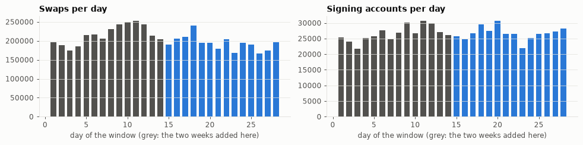
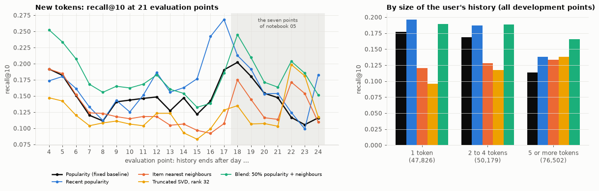

# Token recommendation on 28 days: does the two-week result hold up?

**Short answer: the main result holds, with a smaller gain, and two side
claims do not.** A blend of popularity and item nearest neighbours still
beats the popularity baseline, at 19 of 21 evaluation points. The gain is
+0.034 recall@10, down from +0.051. Nearest neighbours alone no longer match
popularity, and recency turns out to matter more than two weeks suggested.

- **Notebook:** [`src/notebooks/08_token_recommendation_28_days.ipynb`](../src/notebooks/08_token_recommendation_28_days.ipynb)
- **The two-week study it repeats:** [`pool_recommendation_writeup.md`](pool_recommendation_writeup.md)
  and notebook 05
- **The project plan it informs:** [`project_plan_token_recommendation.md`](project_plan_token_recommendation.md)

## 1. What was done

The study of notebook 05 was repeated on twice the data, with nothing
re-tuned.

| | Two-week study (notebook 05) | This study (notebook 08) |
| --- | --- | --- |
| Window | 24 Sep to 8 Oct 2026, blocks 26,049,600 to 26,150,399 | 10 Sep to 8 Oct 2026, blocks 25,948,800 to 26,150,399 |
| Swaps | 2,710,140 | 5,730,197 |
| Transactions | 1,965,611 | 4,060,737 |
| Signing accounts | 211,547 | 368,305 |
| Pools | 24,630 | 38,381 |
| Users after preprocessing | 157,060 | 264,227 |
| Tokens after preprocessing | 19,631 | 31,759 |
| Development points | 7 (after day 4 to 10) | 21 (after day 4 to 24) |
| Users evaluated per point | 6,700 to 8,400 | 6,300 to 10,000 |
| Test point | after day 12 | after day 26 (the same two calendar days) |

- **Same preprocessing:** tokens as items, pass-through tokens and the three
  base currencies removed, binary interactions.
- **Same models and settings:** popularity, popularity of the last day, item
  nearest neighbours (50 neighbours, shrinkage 10), truncated SVD (rank 32),
  and blends with 85% and 50% popularity.
- **Same protocol:** at each point the history is everything earlier, the
  target is the next two days, all tokens are ranked, and recall@10 is
  averaged over users.

**Why the first 14 points matter most.** The last seven development points
(after day 18 to 24) are the seven points of notebook 05, where the settings
and the conclusions were formed. The first 14 points (after day 4 to 17) were
never scored before, so they test those conclusions on data that had no part
in them.

The added two weeks are complete: 99.4% of blocks have a swap, with no
duplicates and no missing values. The tokens of 38,368 of the 38,381 pools
could be read, covering 99.99% of the swaps.



*Daily swaps and signing accounts. Grey: the two weeks added in this study.*

## 2. Results

### 2.1 All models, 21 development points

Recall@10 on new tokens. "Difference" is the mean difference from the
baseline, paired by evaluation point.

| Model | Mean | Lowest | Highest | Difference | Beats baseline at | Coverage |
| --- | --- | --- | --- | --- | --- | --- |
| **Popularity (fixed baseline)** | **0.147** | 0.106 | 0.202 | | | 0.5% |
| Recent popularity (last day) | 0.166 | 0.099 | 0.269 | +0.019 | 16 of 21 | 0.4% |
| Item nearest neighbours | 0.130 | 0.092 | 0.192 | −0.017 | 6 of 21 | 16.8% |
| Truncated SVD, rank 32 | 0.121 | 0.083 | 0.199 | −0.026 | 3 of 21 | 3.5% |
| Blend: 85% popularity + neighbours | 0.166 | 0.117 | 0.221 | +0.019 | 21 of 21 | 0.5% |
| **Blend: 50% popularity + neighbours** | **0.181** | 0.133 | 0.252 | **+0.034** | **19 of 21** | 12.8% |
| Blend: 85% recent popularity + neighbours | 0.186 | 0.109 | 0.287 | +0.039 | 20 of 21 | 0.7% |

### 2.2 Two weeks against four

| Model | Notebook 05, 7 points | The 14 points never scored before | All 21 points |
| --- | --- | --- | --- |
| Popularity (fixed baseline) | 0.155 | 0.148 | 0.147 |
| Recent popularity | 0.156 | 0.170 | 0.166 |
| Item nearest neighbours | 0.158 | 0.125 | 0.130 |
| Truncated SVD, rank 32 | 0.128 | 0.114 | 0.121 |
| Blend: 85% popularity + neighbours | 0.181 | 0.169 | 0.166 |
| Blend: 50% popularity + neighbours | 0.207 | 0.176 | 0.181 |
| Blend: 85% recent popularity + neighbours | 0.179 | 0.188 | 0.186 |



*Left: recall@10 at each development point; the shaded points are those of
notebook 05. Right: recall@10 by the size of the user's history, all
development points pooled.*

### 2.3 Is the gain more than period noise?

The equal blend against the baseline, paired by evaluation point.

| Points | Wins | Mean difference | 95% interval of the mean | Sign test p |
| --- | --- | --- | --- | --- |
| All 21 | 19 | +0.034 | +0.024 to +0.044 | below 0.001 |
| The 14 never scored before | 12 | +0.029 | +0.018 to +0.040 | 0.013 |
| 11 with separate targets (every second point) | 10 | +0.036 | +0.022 to +0.051 | 0.012 |

- **The intervals are bootstrap intervals over points.** Neighbouring points
  share a target day, so the 21 points are not independent. The row with
  separate targets is the cautious one.
- **The two losses are small:** 0.003 and 0.005, after day 16 and 17, where
  recent popularity is far ahead of everything else.

### 2.4 Does a longer history help?

The seven points of notebook 05, scored with the history that notebook had
and with the full history.

| History | Users per point | Tokens | Popularity | Nearest neighbours | Blend 50% |
| --- | --- | --- | --- | --- | --- |
| From day 15: 4 to 10 days (as in notebook 05) | 7,559 | 12,914 | 0.155 | 0.158 | 0.207 |
| From day 1: 18 to 24 days | 8,436 | 26,887 | 0.146 | 0.141 | 0.190 |

- **The first row reproduces notebook 05 exactly.**
- **Every model scores lower with the longer history.** Part of this is a
  harder target: with a longer history fewer tokens are new to a user (22,500
  new pairs per point in place of 25,700). The rest is that every model here
  gives a trade from three weeks ago the same weight as one from yesterday.

### 2.5 The rest

- **Test point (baselines only, as in notebook 05).** Popularity scores 0.154
  after day 26 and recent popularity 0.176. Notebook 05 scored 0.202 and
  0.173 at the same point with a 12-day history.
- **Tokens that cannot be recommended.** Between 10% and 31% of the new pairs
  go to tokens launched inside the two target days, a wider range than the
  15 to 25% seen in two weeks.
- **Age of the tokens users pick up.** After day 24, 25% of the new pairs go
  to tokens that did not exist yet, 73% to tokens older than ten days, and
  2% to anything in between.
- **History size.** The blend is ahead of popularity in every group, most
  clearly for users with five or more tokens (0.166 against 0.114). For
  users with a single token, recent popularity (0.196) is as good as the
  blend (0.190).
- **Variants.** With first-time buys only as the target, without the 5% of
  users with the largest histories, and with pools as items, the order is
  the same: blend, then popularity, then nearest neighbours.

## 3. What holds and what does not

| Claim of the two-week study | On 28 days | Verdict |
| --- | --- | --- |
| Popularity recovers about 16% of first-time tokens | 0.147 on 21 points, 0.148 on the 14 new ones | Holds |
| The level swings with the period far more than with the sample of users | Range 0.106 to 0.202; sampling uncertainty ±0.006 | Holds |
| Popularity blended with neighbours beats popularity consistently | Ahead at 19 of 21 points, 12 of the 14 new ones | Holds |
| The equal blend is a third above the baseline (+0.051) | A quarter above it (+0.034) | Too optimistic |
| Nearest neighbours alone are level with popularity | 0.130 against 0.147, ahead at 6 of 21 points | Does not hold |
| Recency does not reliably help | Recent popularity is ahead at 16 of 21 points, by 0.019 | Does not hold |
| 15 to 25% of the target cannot be reached | 10 to 31% | Holds, wider range |
| Users pick up a token at launch or once it is established | 25% not yet launched, 73% older than ten days | Holds |

**Why the two-week study was too optimistic about the gain.** Two of its
seven points (after day 8 and 9 there, day 22 and 23 here) are the only days
in four weeks where nearest neighbours and SVD are far ahead of popularity.
With seven points they carried a large share of the average.

**How firm the new finding on recency is.** Recent popularity is better on
average, but four points (after day 15, 16, 17 and 24) carry much of the
gain, and on the 11 points with separate targets it is ahead at 8 (sign test
p = 0.23). It is a reason to add recency to the models, not a result to
report as settled.

## 4. What this changes in the project plan

- **The fixed baseline stays.** Popularity over the whole history has no
  setting and a stable level. Its expected value on more data is about 0.15.
- **Recent popularity is reported next to it.** A proposed model should beat
  both, since recent popularity is the stronger simple reference on 28 days.
- **Time comes first in the modelling work.** Before tuning neighbours or
  ranks, weight interactions by age or limit the history to a recent window,
  and treat the length of that window as a setting. The unweighted models
  get worse with more history, which the 12-week extension would otherwise
  make worse still.
- **The expected gain is about 0.03, not 0.05.** The success criterion of the
  plan (an interval of the paired difference that excludes zero) is unchanged
  and is met here on development data.
- **Which blend to carry forward is open.** The blend with recent popularity
  has the best average (0.186), the equal blend with all-time popularity has
  much higher coverage (12.8% against 0.7%). This is a choice for the
  development periods of the plan, not for the test period.
- **Many evaluation points remain necessary.** Seven points gave one wrong
  and one overstated conclusion.

## 5. Limitations

- **Still one month of one chain.** The 14 new points are earlier in time
  than the points the settings were formed on, not later. They are untouched
  data, but not a forecast into the future.
- **The seven points of notebook 05 are not a clean repeat.** With a longer
  history the set of tokens that are new to a user changes, so the scores at
  those points are not directly comparable to notebook 05. Section 2.4
  separates the two.
- **The test point has now been looked at twice** for the baselines. The plan
  already reserves a later period (8 October to 5 November) as the test set.
- **Nothing was tuned,** so these numbers say what the untuned models do, not
  what collaborative filtering can do.

## 6. Reproducing this

```bash
uv run python src/scripts/dex_swaps.py --start 25948800 --blocks 100800 --workers 2
```

- **Download:** the command above fetches the two added weeks in about an
  hour. The free endpoint reported a rate limit once; the download is
  resumable, so running the command again continues it.
- **Notebook:** with the data in place, notebook 08 runs in about 15 minutes.
  It reads the tokens of the new pools on its first run (about ten minutes
  more).
- **Data files** stay in `data/dex_swaps/` and are not committed.
